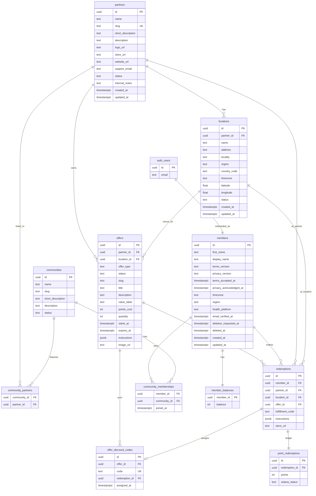
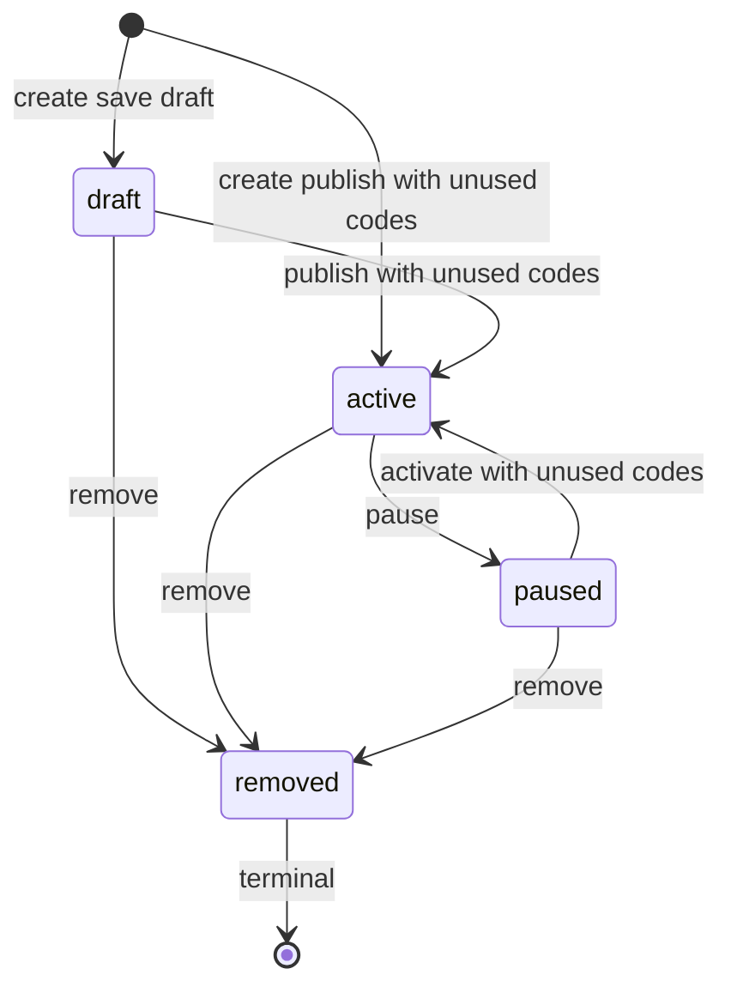

# Database model

Target production-minded schema for Brew & Move core entities. Use this when adding tables or columns so we avoid repeated production migrations.

Some entities and columns below are **not on `main` yet**. Treat this document as the intended shape; migrations implement it slice by slice. Product rules in [`AGENTS.md`](../AGENTS.md) still govern what we collect and what we defer.

## Entity relationship diagram

## Offer status

Discount-code offers use `draft | active | paused | removed`. This is a CHECK plus a single private transition RPC — not a formal state machine.

Locked rules:

1. `removed` is terminal.
2. `draft` only when staff saves a draft instead of publishing directly. Venue offers do not use a draft lifecycle.
3. Moving to `active` requires at least one unused discount code.

| from \ to | draft | active | paused | removed |
|-----------|:-----:|:------:|:------:|:-------:|
| **create (save draft)** | yes | — | — | — |
| **create (publish)** | — | yes\* | — | — |
| **draft** | noop | yes\* | — | yes |
| **active** | no | noop | yes | yes |
| **paused** | no | yes\* | noop | yes |
| **removed** | no | no | no | noop |

\* Guard: unused code pool count ≥ 1.

## Partners

| Field | Purpose |
|-------|---------|
| `name` | Display name |
| `slug` | Stable public / admin id |
| `short_description` | Card blurb |
| `description` | Long member-facing about copy |
| `logo_url` | Card / header identity |
| `store_url` | Post-redeem open-store CTA |
| `website_url` | Optional brand site, distinct from checkout |
| `support_email` | Staff ops contact — not a partner login |
| `status` | `active` / `paused` / `removed` |
| `internal_notes` | Staff-only; never expose on member catalog |
| `created_at` / `updated_at` | Audit |

Do not add yet: settlement bank details, tax IDs, partner balances, invoices, partner login, or scanner device ids. Those stay outside the MVP.

## Members

Email lives on `auth.users`. The member row is the onboarding profile.

| Field | Notes |
|-------|--------|
| `first_name` | Immutable after insert |
| `display_name` | Member-editable |
| Legal version + acceptance timestamps | Required at onboarding |
| `timezone` / `region` | Detected from device; should stay refreshable |
| `health_platform` | `apple_health` / `health_connect` / null |
| `email_verified_at` | Non-blocking for earn / redeem |
| `deletion_requested_at` / `deleted_at` | Production deletion scaffolding |
| `created_at` / `updated_at` | Audit |

Do not collect: surname, username, phone, gender, full date of birth, home address, profile photo, or a Solana wallet address.

## Related read paths

- Member Rewards catalog should read through a view such as `catalog_offers`, not the private code pool.
- Discount codes live in `private` and stay off the Data API; members see an assigned code only via a redemption snapshot (`fulfillment_code`, `instructions`, `store_url`).
- Café settlement tables and RPCs remain separate from the discount-code redeem path.
